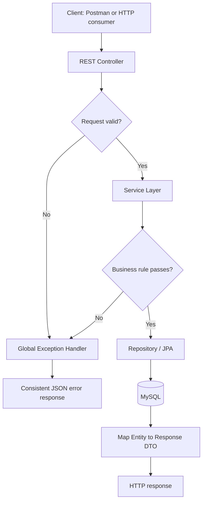
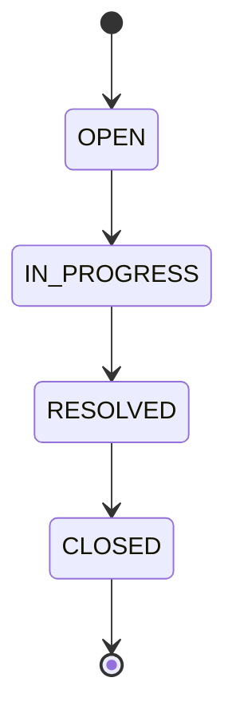

# Application Flow — TicketDesk API

## 1. High-level request flow


## 2. Create a user
1. Client sends `POST /api/users`.
2. Controller validates the request.
3. User service checks email uniqueness / handles a duplicate constraint.
4. Repository saves the user.
5. API returns `201 Created` with a user response DTO.
6. If email already exists, return `409 Conflict`.

## 3. Create a ticket
1. Client sends `POST /api/tickets` with title, description, priority, and `createdBy`.
2. Controller validates the DTO.
3. Service verifies that the creator user exists.
4. Service creates a ticket with status `OPEN`.
5. Repository persists it.
6. API returns `201 Created` with a ticket response DTO.
7. Missing creator returns `404`; invalid fields return `400`.

## 4. List/search tickets
1. Client calls `GET /api/tickets?page=0&size=5` and may include `status` and/or `priority`.
2. Controller parses filters and pagination.
3. Service/repository applies the requested criteria.
4. API returns a paginated response.
5. Validate pagination inputs and define a sensible maximum page size.

## 5. Update ticket details
1. Client sends `PUT /api/tickets/{id}`.
2. Service looks up the ticket.
3. If missing, return `404`.
4. Validate title and priority, update permitted fields only, save, and return `200`.

## 6. Change ticket status

- Only one forward step is permitted per request.
- Skipping a state or moving backwards returns `400`.
- Repeating the same status is not a valid transition under the strict next-step rule.
- Test each valid transition and invalid skip/backwards transition.

## 7. Add/list comments
- Add: `POST /api/tickets/{id}/comments`; validate ticket, author, and non-empty message; persist; return `201`.
- List: `GET /api/tickets/{id}/comments`; confirm ticket exists and return its comments.
- Ticket deletion cascades to comments at the database relationship level.

## 8. Delete a ticket
1. Client sends `DELETE /api/tickets/{id}`.
2. Service checks existence.
3. Repository deletes the ticket.
4. Return `204 No Content`.
5. If absent, return `404`.

## 9. Common error flow
All exceptions are translated into a stable response:
```json
{
  "timestamp": "2026-10-22T19:12:00",
  "status": 404,
  "error": "Not Found",
  "message": "Ticket not found with id 99",
  "path": "/api/tickets/99"
}
```
Validation errors should return HTTP 400 with field-specific messages. Avoid leaking stack traces.
